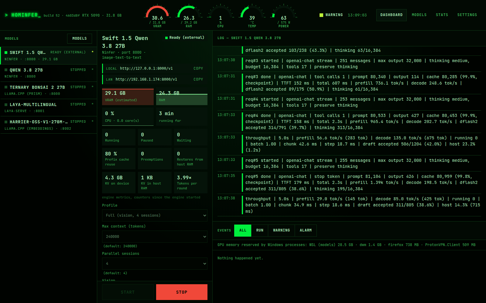
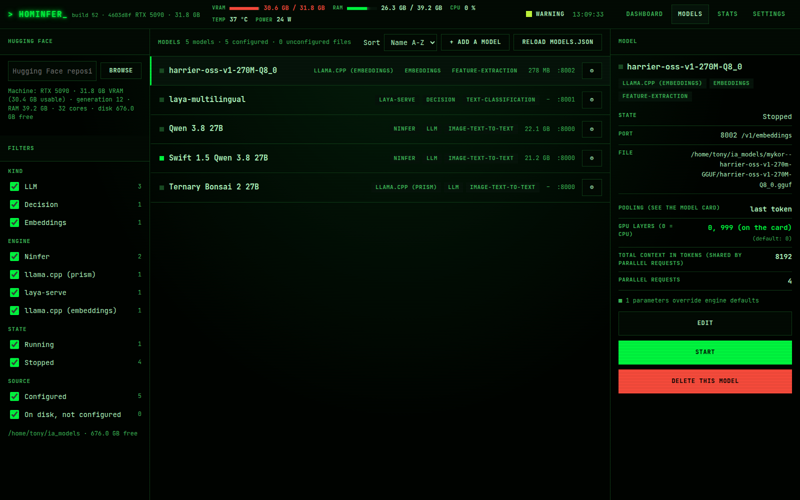
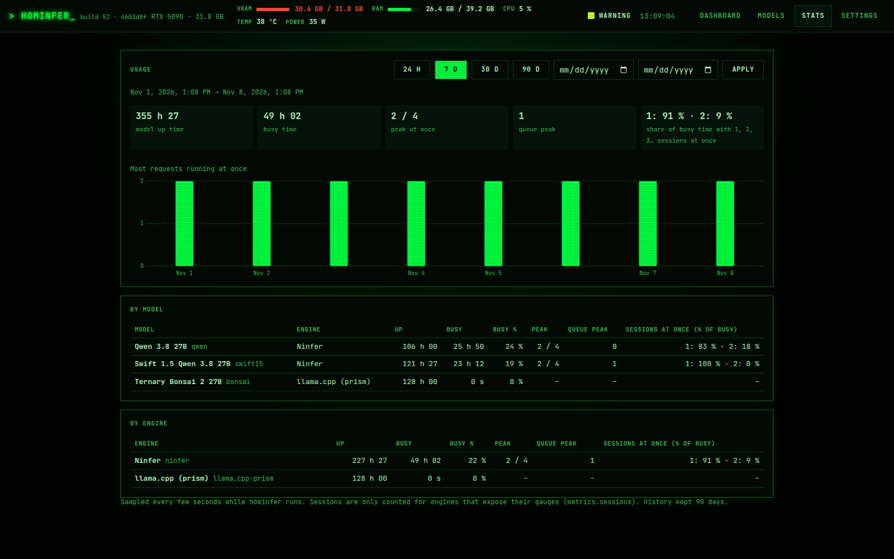
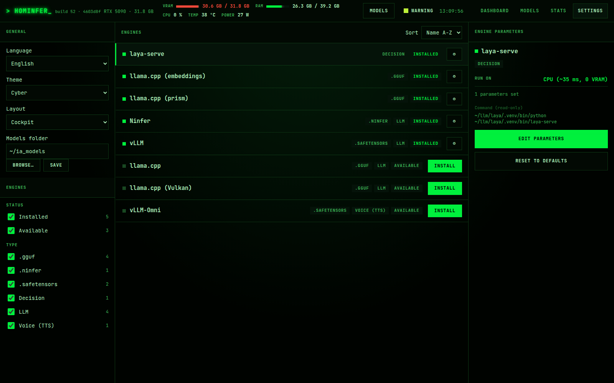
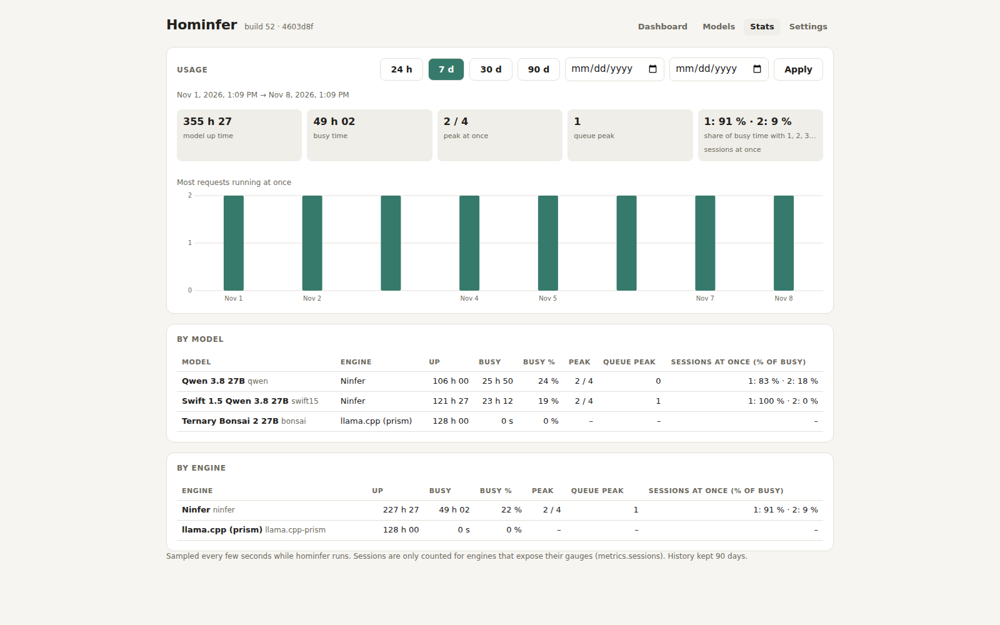
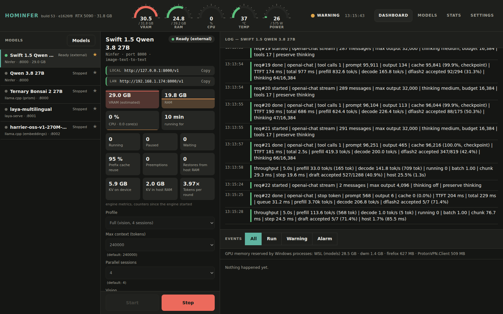
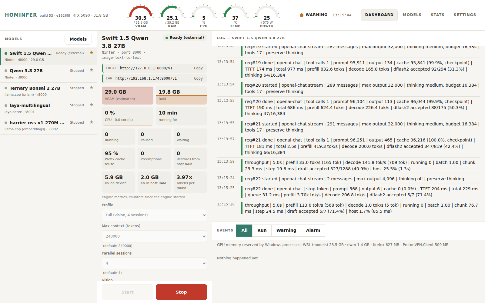
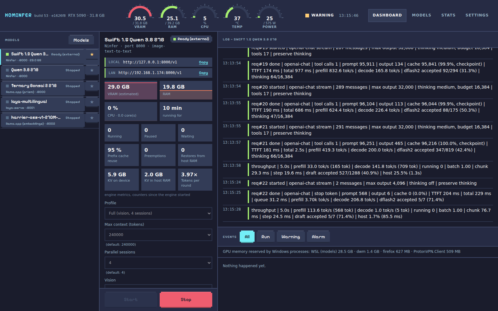
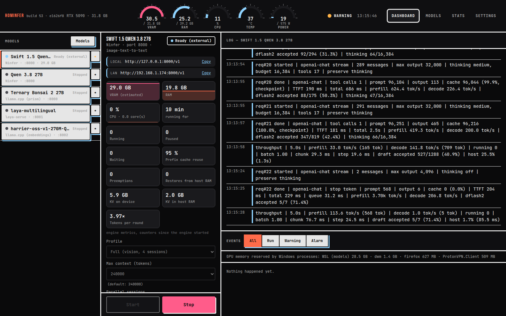

# Hominfer


Run local AI models like home services. Paste a Hugging Face repo and it tells you which variants fit
your GPU, installs the engine you're missing, and gives every model a card to start, stop and profile —
with live VRAM, RAM, CPU and GPU load.

Engine-agnostic by design: llama.cpp, vLLM, Ninfer and friends are configuration, not code.
Linux / WSL2, NVIDIA or AMD (APUs included).



## Features

- **Start / stop models** with profiles (context size, parallel sessions, vision, CPU or GPU…), from any
  browser on your LAN
- **Live usage**: VRAM per model (measured on AMD, inferred on NVIDIA since `nvidia-smi` under WSL
  doesn't report per-process memory), RAM, CPU, GPU load and temperature
- **Hugging Face browser**: paste a repository and get a "does it run here?" verdict for every variant,
  based on your GPU, your installed engines and free disk, then download what fits
- **Engine catalog**: install llama.cpp, vLLM and others from the page when a model needs one, with no
  sudo (the CUDA toolkit comes from NVIDIA's pip wheels; AMD and Intel get a Vulkan build of llama.cpp)
- **Engine metrics**: running / waiting requests, prefix cache reuse, KV cache, and how many sessions a
  model really serves at once, for engines that expose them
- **Stats**: usage history per model and per engine (up time, busy time, peak and concurrent sessions)
  over the last 24 hours, 7, 30 or 90 days, or any date range
- **Logs and events**: live engine log, the exact command line, extra arguments, and an event log
  (starts, crashes, warnings)
- **Auto-restart**: an engine that dies or stops answering after being ready is restarted
- **Library**: every model file of your models folder, which model uses it, and cleanup
- **Themes and layouts**: six themes (auto, light, dark, cyber, pixel, neo) and two layouts: *classic*
  (one scrolling page) and *cockpit* (dense multi-pane console); UI in English or French
- Port conflict detection; missing engine prerequisites are listed before installing; the models the
  launcher started stop with it
- The machine doesn't go to sleep while a model is loaded (Windows under WSL, systemd-logind on Linux)

| Models | Stats |
|---|---|
|  |  |
| **Settings** | **Stats (classic layout, light theme)** |
|  |  |

### Themes

The screenshots above use the *cockpit* layout with the *cyber* theme. The same dashboard with the other
themes:

| Dark | Light |
|---|---|
|  |  |
| **Pixel** | **Neo** |
|  |  |

Pick them in **Settings**; [docs/theming.md](docs/theming.md) explains how to add your own.

## Requirements

- Linux or WSL2 (Ubuntu tested), with systemd for the optional boot service
- An NVIDIA GPU with its driver (`nvidia-smi`), or an AMD GPU on the `amdgpu` driver. The page still works
  without one, but most engines need it. On AMD only llama.cpp (Vulkan) is offered for now.
  Several GPUs are untested: the launcher reads only one card (the first on NVIDIA, the one with the most
  VRAM on AMD), so VRAM figures and the free-VRAM check cover that card alone. An engine's `env` in
  `engines.json` (e.g. `CUDA_VISIBLE_DEVICES`) can pin it to a card
- [uv](https://github.com/astral-sh/uv) (installed by the script below if missing)
- To build engines from the catalog: `sudo apt install git cmake ninja-build build-essential`

## Getting started

```sh
curl -LsSf https://raw.githubusercontent.com/ikarys/hominfer/main/install.sh | bash
hominfer              # http://127.0.0.1:8090
```

The page listens on this machine only by default. To open it from the LAN and start it at boot
(systemd, under WSL `[boot] systemd=true` in `/etc/wsl.conf`):

```sh
curl -LsSf https://raw.githubusercontent.com/ikarys/hominfer/main/install.sh | bash -s -- --service --lan
```

The page has no login: only expose it on a network you trust. Running the script again upgrades.
Configuration goes to `~/.config/hominfer`, logs to `~/.local/state/hominfer/logs`.

On first start there is no model and no engine yet:

1. **Settings → Inference engines**: install an engine (llama.cpp is the most versatile)
2. **Models → Download from Hugging Face**: paste a repository, pick a variant that fits, download it
3. **Library → Add as a model**, then start it from the **Dashboard**

From a git checkout instead: `just run` (needs [just](https://github.com/casey/just)), and
`just install-service` for the systemd service (reachable from the LAN).

## Documentation

- [How-to guides](docs/how-to.md): install an engine, add a model, profiles, custom engines, languages…
- [Configuration](docs/configuration.md): `engines.json`, `models.json`, `settings.json`, environment variables
- [Architecture](docs/architecture.md): how the code is organised
- [Theming](docs/theming.md): add a theme or a page layout
- [Contributing](CONTRIBUTING.md)

## License

[MIT](LICENSE)
